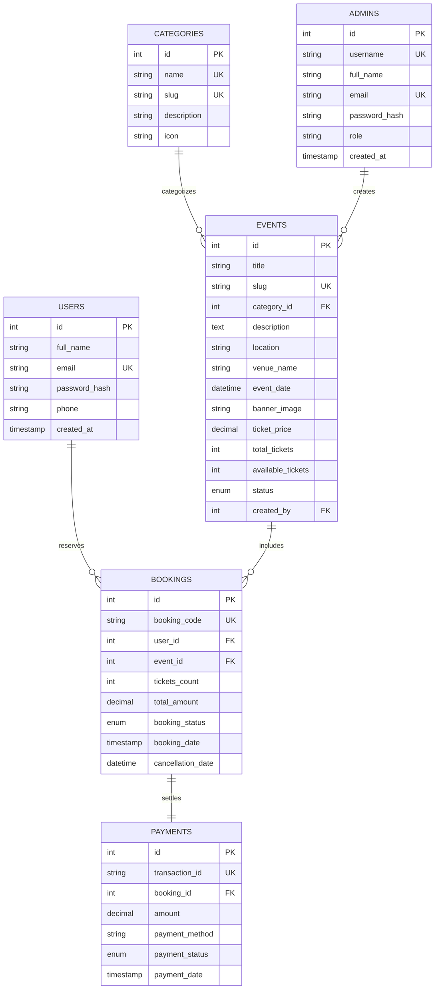

# EventEase — Modern Full Event Management & Ticketing System

<p align="center">
  
</p>

<p align="center">
  <strong>A modern, enterprise-grade event management and ticketing platform built with Python Flask, MySQL, and vanilla modern HTML5/CSS3/JavaScript.</strong>
</p>

<p align="center">
  
  
  
  
  
</p>

---

## 🌟 Overview & Key Highlights

**EventEase** is a comprehensive, production-ready web application designed for both event organizers and attendees. It delivers a modern, responsive user experience paired with a relational database backend that enforces transactional integrity and prevents overselling.

- **Dynamic Public Portal**: Hero banner, live category filter pills, real-time debounced keyword search, and interactive event detail cards.
- **Transactional Ticketing**: Alphanumeric reservation codes (`EE-XXXXXX`), live inventory decrement, and digital pass vouchers with simulated printable QR receipts.
- **Self-Service Attendee Hub**: Profile management, booking history audits, and real-time cancellation with automated ticket replenishment.
- **Comprehensive Admin Control Center**: Telemetry metrics, gross revenue tracking, SVG data visualizer, event CRUD, booking monitoring, user management, and executive audit reports.
- **Dual-Engine Relational Storage**: Full native MySQL 8.0 support with clean parameterized PyMySQL execution, paired with an automatic SQLite fallback for instant zero-config demonstration.

---

## 🏗️ Technology Stack

| Layer | Technologies Used |
| :--- | :--- |
| **Backend** | Python 3.13 / 3.11+, Flask 3.1, Werkzeug (PBKDF2 Password Hashing) |
| **Database** | MySQL 8.0 (InnoDB, Foreign Keys, Indexes) with PyMySQL connection pooling &amp; SQLite fallback |
| **Frontend** | HTML5, CSS3 Custom Properties (Design Tokens), Vanilla Modern JavaScript (ES6+) |
| **Typography &amp; Icons** | Plus Jakarta Sans, Inter, FontAwesome 6 |
| **Testing** | Python `unittest` integration suite covering authentication, transactions, and admin operations |

---

## 🗄️ Relational Database Architecture

The system utilizes 6 relational tables with strict foreign keys and index optimization:



---

## 🚀 Quick Start Guide

### 1. Clone the Repository
```bash
git clone https://github.com/your-username/eventease.git
cd eventease
```

### 2. Set Up Virtual Environment (Recommended)
```bash
# Windows
python -m venv venv
venv\Scripts\activate

# macOS / Linux
python3 -m venv venv
source venv/bin/activate
```

### 3. Install Dependencies
```bash
pip install -r requirements.txt
```

### 4. Configure Database (.env)
Copy `.env.example` to `.env` and set your MySQL password:
```ini
SECRET_KEY=eventease-super-secret-key-2025-portfolio

# Primary Database Engine
DB_ENGINE=mysql

# MySQL Database Configuration
MYSQL_HOST=localhost
MYSQL_PORT=3306
MYSQL_USER=root
MYSQL_PASSWORD=your_actual_mysql_password
MYSQL_DB=eventease_db

FLASK_DEBUG=1
```

### 5. Verify MySQL Connection
Run the built-in diagnostic tool to test your MySQL connection and verify `eventease_db`:
```bash
python check_db.py
```

### 6. Seed Database & Sample Data
Initialize all tables and populate realistic events, categories, sample attendees, and default admin:
```bash
python seed_data.py
```

### 7. Launch the Application
```bash
python app.py
```
Open your browser and navigate to:
```
http://127.0.0.1:5000
```

---

## 🔑 Demo Access Credentials

| Role | Username / Email | Password | Access Area |
| :--- | :--- | :--- | :--- |
| **System Admin** | `admin` (or `admin@eventease.com`) | `Admin@123` | [Admin Console](http://127.0.0.1:5000/admin/login) |
| **Attendee User** | `john.doe@example.com` | `User@123` | [User Login](http://127.0.0.1:5000/login) |
| **Attendee User** | `sarah.j@example.com` | `User@123` | [User Login](http://127.0.0.1:5000/login) |

*(Quick "Autofill" buttons are built into both login forms for convenience during presentations and reviews).*

---

## 🧪 Automated Testing

EventEase includes an end-to-end integration and unit test suite verifying:
- Route rendering and template bindings
- Category and live search filtering
- Transactional ticket decrement and oversell prevention
- Self-service booking cancellation with automatic ticket inventory return
- Full Admin CRUD and executive report analytics

Run all tests:
```bash
python -m unittest test_app.py -v
```

---

## 📁 Project Structure

```
event_management/
│
├── config.py                  # Database & application configuration
├── app.py                     # Flask application factory, controllers & routes
├── database.py                # Database connection manager (MySQL + Fallback)
├── schema.sql                 # MySQL schema with foreign keys and indexes
├── seed_data.py               # Database seeder with realistic test records
├── test_app.py                # Full automated test suite
├── requirements.txt           # Python dependencies
├── .env.example               # Environment variables template
├── README.md                  # System documentation
│
├── static/
│   ├── css/
│   │   ├── style.css          # Core design tokens, components & utilities
│   │   ├── admin.css          # Admin console sidebar, tables & metric cards
│   │   └── responsive.css     # Mobile & tablet layout adaptations
│   ├── js/
│   │   ├── main.js            # Live search filtering, toast alerts, modals
│   │   ├── booking.js         # Real-time ticket pricing & checkout calculator
│   │   └── admin.js           # SVG charts, table filters & delete prompts
│   └── images/
│       ├── logo.svg           # EventEase brand identity
│       ├── default-avatar.svg # User profile avatar
│       └── banners/           # High-resolution themed event graphics
│           ├── tech_summit.svg
│           ├── music_fest.svg
│           ├── business_networking.svg
│           ├── art_exhibit.svg
│           ├── marathon.svg
│           ├── culinary_fair.svg
│           └── default_event.svg
│
└── templates/
    ├── base.html              # Base client layout with navigation & footer
    ├── index.html             # Landing page with hero, search & featured events
    ├── events.html            # Event schedule catalog with category filters
    ├── event_details.html     # Single event view with interactive booking widget
    ├── booking.html           # Review & payment checkout
    ├── booking_success.html   # Printable admission voucher with QR preview
    ├── profile.html           # Attendee bookings, cancellations & profile update
    ├── login.html             # User authentication
    ├── register.html          # New attendee registration
    ├── about.html             # Platform mission & architecture highlights
    ├── contact.html           # Inquiries & organizer support form
    │
    └── admin/
        ├── base_admin.html    # Admin console wrapper with sidebar
        ├── login.html         # High-security admin login
        ├── dashboard.html     # KPI metrics, revenue chart & inventory watchlist
        ├── events.html        # Event management table with status toggling
        ├── event_form.html    # Add / Edit event with datetime picker & themes
        ├── bookings.html      # Comprehensive booking audits & cancellations
        ├── users.html         # Attendee directory with spend metrics
        └── reports.html       # Financial summary & category revenue audit
```

---

## 🛡️ Security Features

- **Password Hashing**: Passwords stored using PBKDF2 with SHA-256 and unique salt.
- **Session Protection**: HttpOnly cookie flags, secret key signature validation, and secure session clearing on sign-out.
- **Role-Based Access Control**: Strict `@admin_required` and `@login_required` route decorators guarding all administrative endpoints.
- **SQL Injection Prevention**: All queries execute via parameterized queries (`%s` / `?`).
- **Inventory Concurrency Protection**: Database transactions update ticket counters atomically upon reservation and cancellation.

---

## 📄 License
This project is developed as an open portfolio piece under the MIT License. Feel free to use it for learning or extend it for production deployments.
